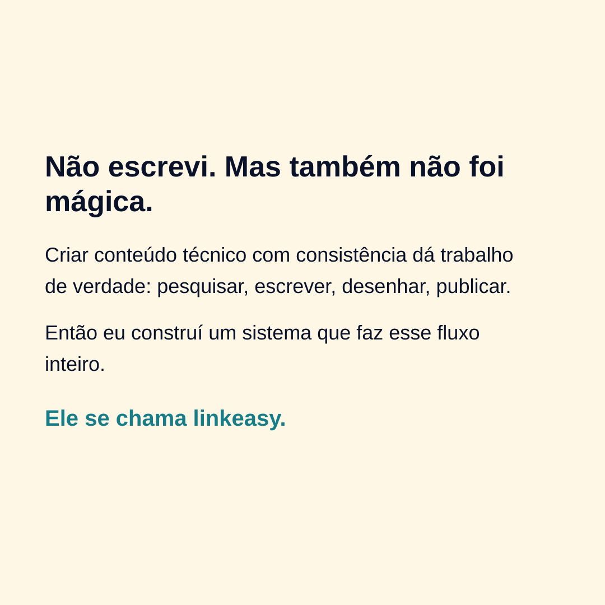
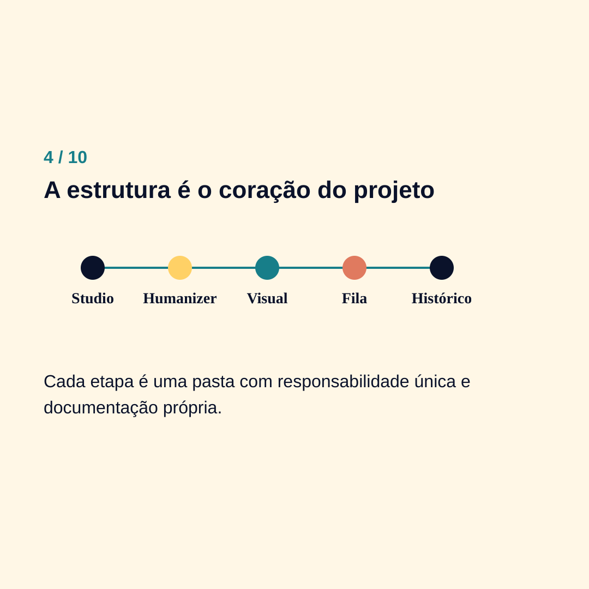
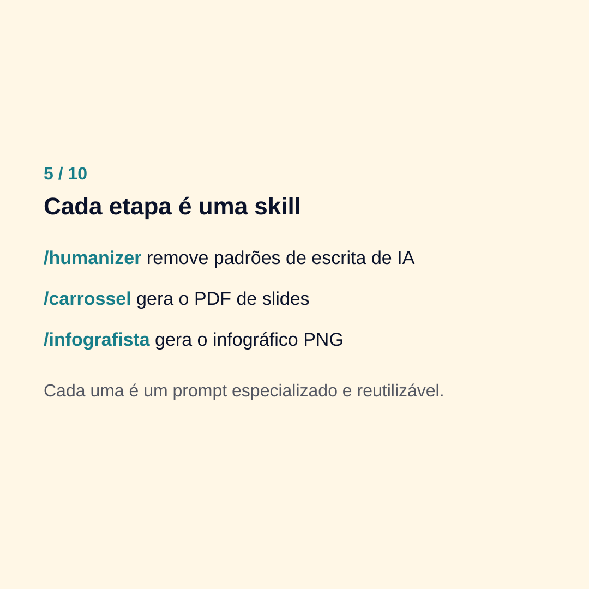
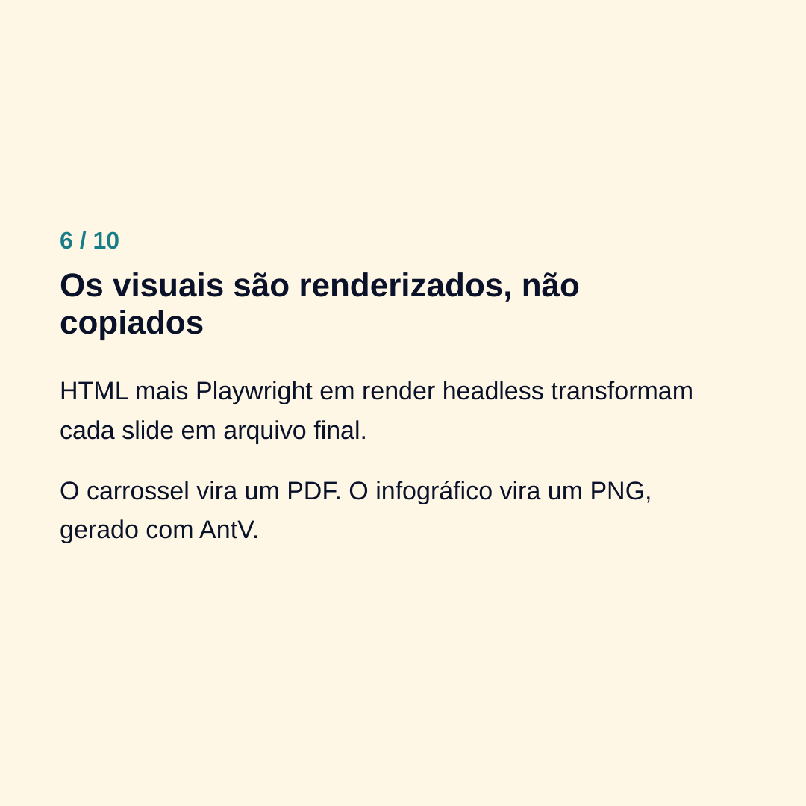
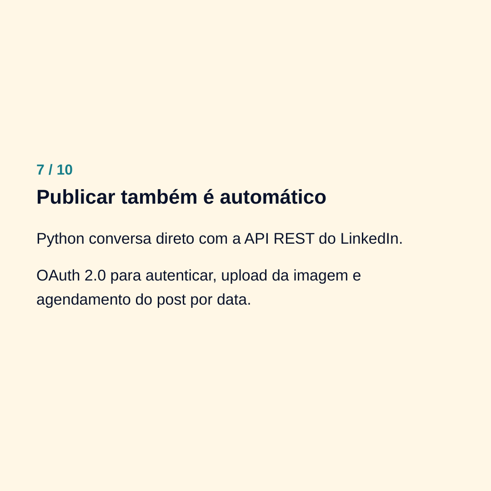
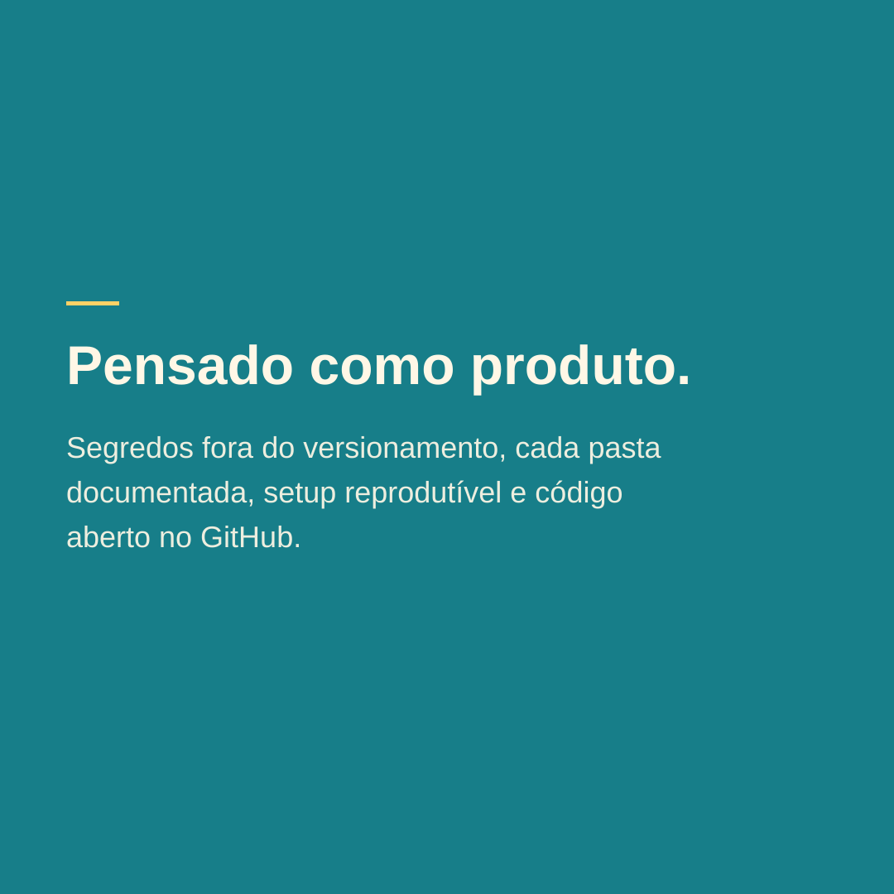
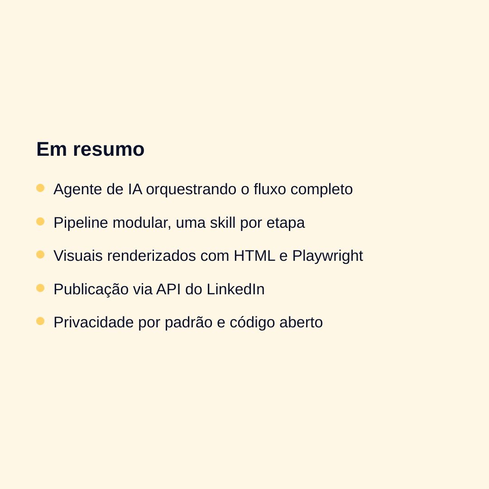
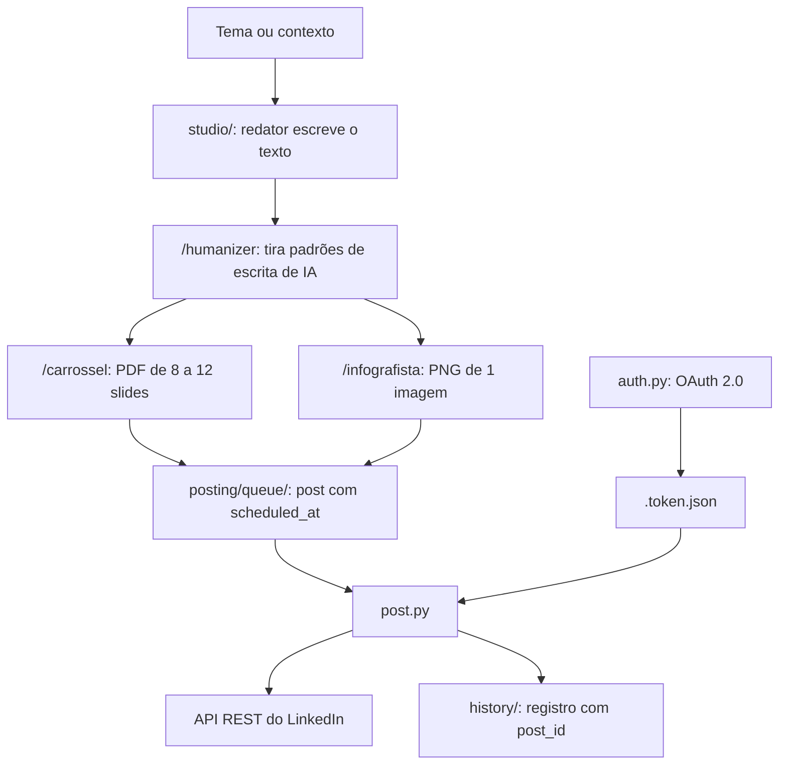

# linkeasy

Eu queria manter uma presença constante no LinkedIn falando de dados, sem passar a noite escrevendo, montando slide e lembrando de publicar na hora certa. O linkeasy é o pipeline que montei pra isso. Eu dou um tema, ele entrega o texto e o visual prontos e publica o post no horário que eu marquei.

**TL;DR (English).** linkeasy is a LinkedIn content pipeline orchestrated by an AI agent (Claude Code) with specialized skills. From a single topic it drafts the post, strips AI writing patterns, renders a PDF carousel or a PNG infographic with Playwright, and queues the post with a schedule. A Python script publishes due posts through the LinkedIn REST API (OAuth 2.0) and records the returned post ID before moving the file to history, so a run that crashes before the move does not publish the same post again. Publishing code is covered by pytest with the API mocked, and CI runs lint, tests and a render smoke test.

[](https://github.com/romualdobarbosa/linkeasy/actions/workflows/ci.yml)
[](LICENSE)
[](pyproject.toml)

## Demonstração

O carrossel abaixo não foi feito à mão. Eu dei um tema só ao linkeasy, "explique o próprio linkeasy para um recrutador", e ele tocou o processo inteiro. Escreveu o texto, planejou os slides, aplicou a identidade visual e gerou o PDF. É a saída real da ferramenta, sem nenhum retoque meu.

Pra mim, é a forma mais honesta de mostrar o que o linkeasy faz. Deixo ele se explicar. Os slides abaixo estão na ordem em que saíram.


<details>
<summary>Ver o carrossel completo (9 slides)</summary>

<br>










</details>

## Em números

| Métrica | Valor | De onde vem |
|---|---|---|
| Posts publicados no LinkedIn pela ferramenta | 3 | Arquivos com `status: published` em `history/`. A pasta fica fora do repositório porque é conteúdo pessoal. Não conta um post de teste. |
| Carrosséis renderizados | 4 | PDFs gerados localmente em `carousel_studio/rascunhos/`. Um deles é a demonstração deste README. |
| Testes automatizados | 78 | `make test` (pytest), roda no CI a cada push |
| Cobertura de `post.py` e `auth.py` | 99% (3 de 412 linhas sem cobertura) | `make test` (pytest-cov), roda no CI a cada push |

## Como funciona



Da ideia até a fila, é um pipeline de conteúdo orquestrado por agente de IA (Claude Code) com skills especializadas. Um agente só segue o fluxo descrito no `CLAUDE.md` e chama a skill de cada etapa. A publicação fica com dois scripts Python que rodam fora do agente.

O formato visual depende do conteúdo:

- `/carrossel` quando o post tem estrutura de lista, passos ou uma narrativa com vários pontos. Exporta um PDF de 8 a 12 slides.
- `/infografista` quando o post tem um dado central, uma comparação ou uma sequência curta. Gera uma imagem PNG.

### Skills

As skills ficam em `.claude/skills/`, cada uma é um arquivo de instruções para uma etapa.

| Skill | Função |
|---|---|
| `/humanizer` | Remove sinais de escrita gerada por IA antes de aprovar um post |
| `/carrossel` | Planeja os slides em HTML e renderiza o PDF com Playwright (`carousel_studio/render.mjs`) |
| `/infografista` | Escolhe um template do AntV Infographic e renderiza o PNG com Playwright (`infographic/render.mjs`) |

O texto do post vem do redator, cujas regras estão em `studio/redator.md`.

### Publicação

- `auth.py` faz o fluxo OAuth 2.0. Abre o navegador, recebe o código num servidor local em `http://localhost:8000/callback`, troca por um access token e salva em `.token.json` com a data de obtenção e permissão 0600.
- `post.py` lê `posting/queue/*.md`, publica os posts cujo `scheduled_at` já passou (horário de America/Sao_Paulo, ou do fuso em `LINKEASY_TZ`) e move cada um, junto com a pasta de imagens, para `history/`. Uma imagem vai como imagem única, de 2 a 20 vão como multiImage.

O formato do frontmatter e as regras da fila estão em `posting/CONTEXT.md`.

## Decisões e trade-offs

**Publicação sem duplicar.** Criar post na API do LinkedIn não é idempotente. Se o script publicasse e só depois movesse o arquivo, uma queda entre os dois passos faria a próxima execução publicar de novo. Por isso, logo depois do 2xx, o `post.py` grava `status: published`, `published_at` e o `post_id` (header `x-restli-id`) no frontmatter, com escrita atômica, e só então move para `history/`. Na execução seguinte, post com `post_id` não é publicado de novo, só tem o registro concluído. É entrega at-least-once com deduplicação pelo ID. Se o destino já existir em `history/`, o script para em vez de sobrescrever.

**Não repetir a criação do post em erro 5xx.** O retry com backoff vale para 429 em qualquer chamada. Erro 5xx e queda de conexão no meio da leitura só são repetidos no upload de imagem. Na criação do post, um 5xx pode significar que o LinkedIn criou o post e falhou depois, então o script para e pede pra conferir no LinkedIn antes de rodar de novo. O preço é conferir à mão de vez em quando, e em troca não aparece post duplicado no perfil.

**`state` aleatório no OAuth.** O `auth.py` gera um `state` novo a cada execução com `secrets.token_urlsafe` e confere no callback com `secrets.compare_digest`. Callback com `state` errado é descartado. É o que impede outra página de injetar um código de autorização no meu servidor local.

**Skills especializadas em vez de vários agentes.** Cada etapa (redação, humanização, carrossel, infográfico) é uma skill com instruções próprias, chamada pelo mesmo agente. O fluxo é linear, então um agente chamando as skills em sequência dá conta, sem nenhuma comunicação entre agentes. E quando uma etapa sai ruim, o ajuste fica num arquivo só.

**Carrossel em PDF publicado à mão.** O `post.py` só envia imagens png, jpg e jpeg. A API do LinkedIn aceita PDF, mas eu quase não vejo carrossel no meu feed e publico bem mais post com imagem, então não compensou manter mais um fluxo de upload. O raciocínio completo está em [`docs/adr/0001-carrossel-pdf-publicado-a-mao.md`](docs/adr/0001-carrossel-pdf-publicado-a-mao.md).

## Bugs que valeram a pena

**O post que podia sair duas vezes.** A primeira versão do `post.py` publicava e só depois movia o arquivo da fila. Achei isso relendo o código. Se o processo caísse entre um passo e outro (queda de rede, notebook fechado), o arquivo continuava na fila e a próxima execução publicava o mesmo post de novo, e no LinkedIn não tem como desfazer isso sem apagar à mão. A correção foi gravar o `post_id` que a API devolve antes de mover, e tratar post com ID como já publicado. É o mesmo raciocínio de entrega at-least-once com deduplicação, e tem um teste que simula a queda exatamente entre os dois passos.

**O código que quebrou sem ninguém mexer nele.** A API do LinkedIn exige o header `LinkedIn-Version` e desativa cada versão depois de mais ou menos um ano. O `post.py` usava a 202506 fixa, e em novembro de 2026 ela já não existia mais. O repositório não tinha mudado nada, mas a próxima publicação ia falhar. Sem token a API responde 401 antes de olhar a versão, então o teste óbvio (chamar sem credencial) não mostrava o problema. Só com uma chamada de leitura autenticada apareceu o 426 `NONEXISTENT_VERSION`. Testei as versões mês a mês, subi pra 202611 e deixei a versão numa constante só, com a data da última conferência.

## Limitações

- A versão da API (`LinkedIn-Version: 202611`, constante `LINKEDIN_VERSION` no `post.py`) foi conferida em 18/11/2026. O LinkedIn tira cada versão de suporte em cerca de um ano e aí responde 426 `NONEXISTENT_VERSION`. Foi assim que descobri que a 202506, que eu usava antes, já tinha saído. Quando esse erro aparecer, é essa constante que precisa subir.
- Carrossel em PDF não é publicado pelo `post.py` (ver a ADR 0001).
- O access token do LinkedIn expira. O prazo vem no `expires_in` da resposta (em torno de 60 dias). O `post.py` recusa token vencido, avisa quando faltam menos de 7 dias, e aí é rodar `uv run auth.py` de novo. Não há refresh token.
- Roda local e não tem agendador. O `scheduled_at` diz a partir de quando o post pode sair, mas alguém precisa executar o `post.py`, à mão ou por um cron configurado na própria máquina.
- Sobra uma janela pequena para publicação duplicada, entre o 2xx da API e a gravação do `post_id` no arquivo. Se o processo morrer exatamente ali, o post não tem ID gravado e sai de novo na próxima execução.
- Os testes do `post.py` e do `auth.py` usam a API mockada (`responses`). Os 3 posts de "Em números" saíram por uma versão anterior do `post.py`. O que entrou depois (gravação do `post_id`, retry, multiImage, checagem do token) eu testei só com a API mockada, ainda não contra a API real.

## Como rodar

Requisitos: [uv](https://docs.astral.sh/uv/) (ele instala o Python 3.12 se faltar) e Node.js 18 ou mais novo.

### Caminho rápido: renderizar os exemplos

Não precisa de conta no LinkedIn. Gera o carrossel e o infográfico de `examples/`:

```bash
npm ci
npx playwright install chromium

node carousel_studio/render.mjs --input examples/carrossel-exemplo.html --output carrossel.pdf
node infographic/render.mjs --input examples/infografico-exemplo.txt --output infografico.png
```

### Caminho completo: publicar no LinkedIn

1. Crie um app em https://www.linkedin.com/developers/ que libere os escopos `openid`, `profile` e `w_member_social`, com o redirect `http://localhost:8000/callback`.
2. Instale as dependências e preencha o `.env`:

   ```bash
   uv sync
   npm ci
   npx playwright install chromium
   cp .env.example .env   # LINKEDIN_CLIENT_ID, LINKEDIN_CLIENT_SECRET, LINKEDIN_PERSON_ID
   ```

3. Autentique e publique a fila:

   ```bash
   uv run auth.py
   uv run post.py
   ```

Para testar a fila, copie `examples/post-exemplo.md` para `posting/queue/` e ajuste o `scheduled_at`. Cuidado, com a data no passado o `post.py` publica de verdade no seu perfil.

O `auth.py` sai com código 0 quando salva o token, 1 em falha do fluxo e 2 quando faltam credenciais no `.env` (nesse caso nem abre o navegador). O `post.py` sai com 0 ou 1.

## Desenvolvimento

```bash
uv sync
uv run pre-commit install   # ruff check e ruff format a cada commit

make lint           # ruff check + ruff format --check
make test           # pytest com cobertura de post.py e auth.py
make render-smoke   # renderiza examples/ e confere o PDF e o PNG (precisa de npm ci e do Chromium)
make all            # os três
```

O CI (GitHub Actions, `.github/workflows/ci.yml`) roda `make lint` e `make test` a cada push e pull request, e num job separado roda o smoke test do render. Esse smoke test gera o PDF do carrossel de exemplo e confere se tem uma página por slide, e gera o PNG do infográfico de exemplo por stdin e por `--input`.

## Estrutura

| Pasta ou arquivo | Propósito |
|---|---|
| `data/` | Insumos para os posts (currículo, certificados, notas). O conteúdo pessoal fica fora do versionamento. |
| `studio/` | Criação do texto dos posts (`redator.md` define as regras de escrita) |
| `carousel_studio/` | Carrosséis em PDF (templates HTML e o renderizador `render.mjs`) |
| `infographic/` | Infográficos PNG (renderizador `render.mjs` e modelos em `Samples/`) |
| `posting/queue/` | Fila de publicação com agendamento |
| `history/` | Registro imutável dos posts publicados |
| `auth.py`, `post.py` | Autenticação e publicação na API do LinkedIn |
| `examples/` | Post, carrossel e infográfico genéricos |
| `tests/` | Testes do `auth.py` e do `post.py` e smoke test do render |
| `.claude/skills/` | As skills do pipeline |

Cada pasta do fluxo tem um `CONTEXT.md` com o papel dela. O `CLAUDE.md` na raiz define a identidade do agente e as regras gerais.

## Stack

- Orquestração: Claude Code, com skills em `.claude/skills/` e regras no `CLAUDE.md`
- Publicação: Python 3.12, requests, python-dotenv, LinkedIn REST API (Posts API e Images API), OAuth 2.0
- Renderização: Node.js, Playwright (Chromium headless), AntV Infographic, HTML e CSS
- Qualidade: uv, Ruff, pre-commit, pytest, pytest-cov, responses
- CI/CD: GitHub Actions

## Privacidade

Dados pessoais (currículo, certificados, foto, posts publicados) ficam só na minha máquina e estão no `.gitignore`. O repositório tem a engenharia do sistema e exemplos genéricos.

## Licença

MIT, veja `LICENSE`.

## Contato

Sou o Romualdo, trabalho com dados e tecnologia. Se quiser conversar sobre o projeto ou sobre oportunidades:

- LinkedIn: https://www.linkedin.com/in/romualdo-barbosa-b43935244/
- GitHub: https://github.com/romualdobarbosa
